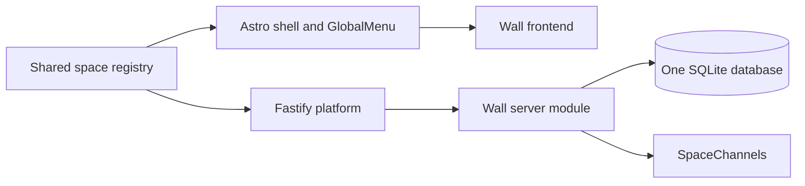

# Architecture

The Open Web is one shared platform with independently implemented spaces. Today, only The Wall is active. Space registration is explicit and static; there is no dynamic module loader or separate service per space.

## Shared platform and space ownership

`packages/shared/spaces.ts` is the source of truth for stable IDs, display labels, canonical frontend paths, and active status. The frontend menu lists active entries only. Tests require each active path to resolve to an Astro route. At startup, the backend verifies that every active entry has exactly one module and that no inactive or unknown module can register routes or realtime subscriptions.

The platform owns the document shell, compact global navigation, shared design tokens, cookie identity, origin and proxy protections, emergency write gate, bounded common rate-limit primitives, SQLite connection and migration runner, realtime connection manager, and operations. A space owns its page and interaction model, server routes, input validation, data-access functions and tables, mutation policy, event payloads, and snapshot/reconciliation behavior.

Spaces communicate with shared services through the `SpaceContext` defined in `apps/server/src/spaces/types.ts`. Modules are registered in `apps/server/src/app.ts`; each module can add routes only under `/api/{space-id}/`. The sole current compatibility exception is The Wall's `/api/session` response. Modules must not import implementation files from other spaces.

## Frontend

Astro serves static pages. `SpaceLayout.astro` provides document structure, typography, tokens, safe-area placement, focus styles, the global menu, and an optional utility slot. Its default `document` mode allows page scrolling. The Wall explicitly selects `layout="viewport"` to preserve its current full-screen canvas behavior. Other spaces can choose the document flow or implement their own content inside the same shell.

`GlobalMenu.astro` derives links and the active path from the shared registry. It is independent of a space's internal page layout and uses a native disclosure control for keyboard and touch operation.

## Backend and persistence

One Fastify process on Node.js 22 handles shared middleware, health, and `/api/events`, then registers each active space module. Shared hooks apply security headers, bounded request caps, origin validation, trusted-proxy handling, and the emergency write gate before space routes.

One `node:sqlite` connection uses WAL and transactional, append-only migrations in `database/migrations`. Space data-access code lives beside its server module. Existing Wall tables and released migrations remain unchanged. SQLite tables are separated by naming and ownership convention; they share one process and database file.

The single-process design is intentional. In-memory IP limits and WebSocket subscriptions are local to that process. No database server, cache, broker, or external realtime service is required.

## Realtime

`SpaceChannels` accepts only registered space IDs. A connection belongs to one space, and a publisher supplied to a module is bound to that space. Shared envelopes use version 1 and include the owning space and event type; the space validates its payload before publishing. Message size, client connection count, per-address connection count, buffered output, and dead sockets are bounded.

Realtime is ephemeral. The platform does not persist events or replay them after reconnect. A space must supply its own initial snapshot and race-free reconciliation behavior. The Wall reloads visible tiles and reconciles tile reads with broadcasts.

## Preserved Wall behavior

The Wall remains a 2,000 × 2,000 canvas divided into 100 × 100 tiles. Palette, 10-second cooldown, overwrite behavior, route paths, event shape, and existing database data are unchanged. Its HTTP endpoints are `/api/wall/tile/:x/:y` and `/api/wall/pixel`; its realtime events remain `{v:1,space:"wall",type:"pixel",x,y,color}`.

See [ADDING-A-SPACE.md](ADDING-A-SPACE.md) for the end-to-end implementation sequence, [DATABASE.md](DATABASE.md) for migration and recovery rules, and [DEPLOYMENT.md](DEPLOYMENT.md) for production release gates.
