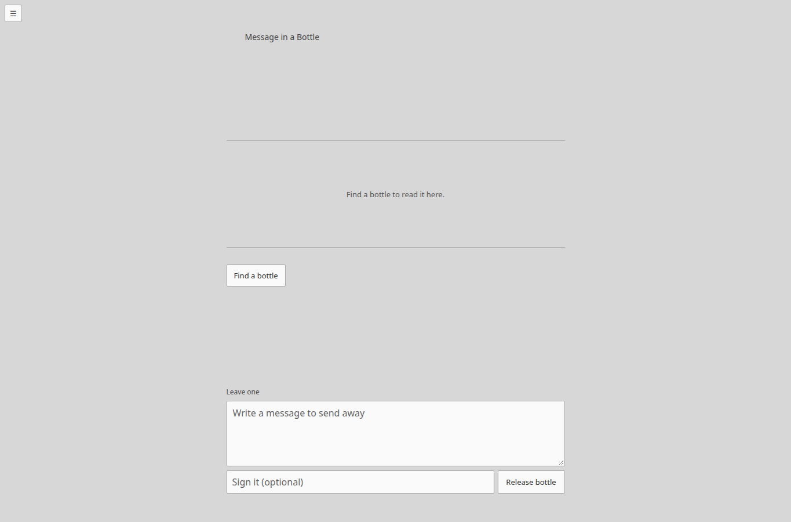
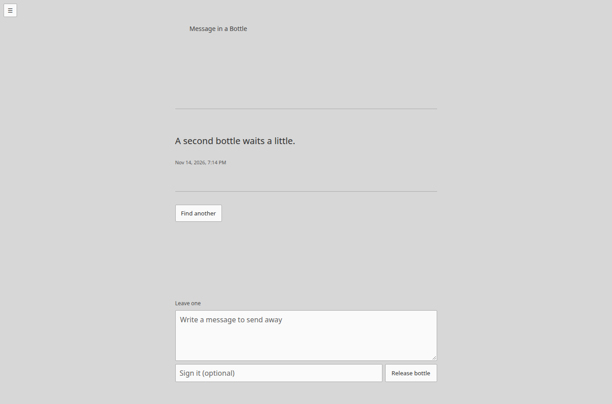
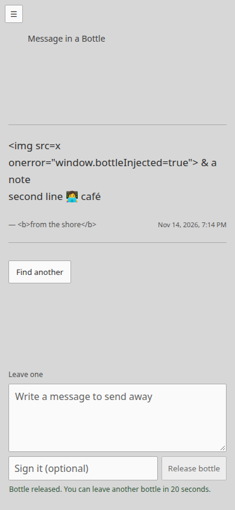

# Message in a Bottle

Message in a Bottle is an asynchronous public space at `/bottle`. A visitor can release a short plain-text message and later find one chosen at random. It has no feed, search, reactions, public identity, realtime connection, or account system. An optional signature is self-declared text and does not verify who wrote the bottle.

Production rollout must deploy the migration-004 compatibility bridge before this Bottle release. The bridge adds no tables; it lets the existing Wall and Chat application validate and open this exact additive schema if Bottle activation or a later code rollback returns to it. Follow [ROLLBACK-COMPATIBILITY.md](ROLLBACK-COMPATIBILITY.md) in order.

## Visitor behavior

- **Find a bottle** requests one random retained message. The page never loads a list or a chronological history.
- **Find another** excludes the last 20 bottle IDs held in that browser's local storage. A bottle released from that browser is included in this small exclusion list so the writer is more likely to find a stranger's note next. The server validates and bounds the list. If the visitor has seen every retained bottle, it clears the local exclusion list and offers a fresh drift on the next request. A browser with unavailable or cleared local storage may see a repeat sooner.
- An empty pool says that no bottles have been released and invites the visitor to leave the first one. No sample message is shown.
- Reading uses plain text via DOM `textContent`; angle brackets, Markdown, links, and HTML remain text. Message line breaks are preserved. Times are stored as UTC Unix milliseconds and displayed in the browser's local time zone.
- A release failure leaves the message and signature in the form. Retrying the same draft reuses a UUID request key so a lost success response does not create a duplicate.

## HTTP contract

All routes use the shared same-origin checks, 1 KiB request body bound, emergency write gate, global request limits, security headers, and trusted proxy handling.

### `GET /api/bottle/random?seen=<uuid,...>`

Returns `{ "bottle": Bottle | null, "exhausted": boolean }` with `Cache-Control: no-store`. The `seen` list is optional, must contain at most 20 UUIDs, and is only a lightweight repeat exclusion supplied by the browser. Selection uses SQLite `ORDER BY random()` over at most 10,000 rows. When no unseen rows remain, `bottle` is null and `exhausted` is true. An empty pool returns null and false. This read route has a bounded per-network token bucket.

Bottle data returned publicly has only `id`, `createdAt`, `message`, and optional `signature`. It does not contain the release cookie, visitor digest, IP address, or a verified author identity.

### `POST /api/bottle/messages`

Accepts JSON `{ "requestId": "<UUIDv4>", "message": "...", "signature": "..." }`. The optional signature may be omitted or empty. Message text is normalized to NFC, line endings are normalized, tabs become spaces, and surrounding whitespace is trimmed. A message must contain non-whitespace text and use at most 500 UTF-8 bytes. Signatures are normalized to one line and limited to 24 Unicode code points and 48 UTF-8 bytes. C0/C1 controls, unpaired surrogates, and directional override/isolate controls are rejected. A message is stored and rendered as plain text.

Successful writes return the server-generated UUID, UTC millisecond timestamp, message, optional signature, duplicate status, and cooldown duration. A visitor can release one bottle every 20 seconds. Process-local limits also allow a 20-request network burst replenished once every three seconds and a global 60-request burst replenished once per second. Discovery allows a 60-request burst per network replenished once per second. These shared in-process limits reset on restart; network addresses are not stored.

## Persistence and retention

Migration 004 creates only Bottle-owned tables:

- `bottle_messages` stores a random UUID, UTC Unix-millisecond creation time, message body, and optional signature. It retains at most 10,000 rows; each release deletes the oldest rows inside the same SQLite transaction.
- `bottle_visitor_cooldowns` stores the shared anonymous visitor digest and last release time for abuse control. Digests expire after the 20-second cooldown and maintenance removes expired rows; the table is capped at 10,000 entries. The digest is never stored with a public bottle.
- `bottle_idempotency` stores the visitor digest, client UUID request key, timestamp, and bottle UUID to safely replay a release response. Entries expire after 24 hours and are capped at 10,000. The digest and request key are never returned to visitors.

The tables are separate from Wall and Chat. There is no history/archive table and no realtime event. SQLite WAL and the existing online-backup/release process remain shared infrastructure.

## Operator removal

Removal is by the server-generated UUID. First read the active service's configured `DB_PATH`; do not guess or point the tool at a different database. On the production host, run:

```sh
sudo env DB_PATH=/var/lib/the-open-web/open-web.sqlite \
  node /opt/the-open-web/current/dist/apps/server/src/spaces/bottle/remove-bottle.js \
  00000000-0000-4000-8000-000000000000
```

Replace the example path with the actual configured database path and the final argument with the bottle ID. The command validates the Bottle migration and UUID, deletes only that row, and reports if no matching bottle exists. There is no public removal endpoint or moderation console. Removal is immediate for subsequent random discovery. It does not notify any already-open page because Bottle uses no realtime channel.

## Verification

`tests/bottle.test.ts` covers validation, byte bounds, origin and write gates, anonymous identity privacy, cooldown, idempotency, random exclusions, empty/exhausted states, restart persistence, 10,000-row pruning, removal, and coexistence with Wall and Chat. `tests/bottle.browser.mjs` checks desktop, large desktop, tablet, narrow mobile, and landscape sizing; keyboard release; local-time display; script-like text; cooldown; draft recovery; and discovery. The shared menu, accessibility, compiled HTTPS, production-only operator, full load, and release checks also include the third active route.

### Browser screenshots

Captured with synthetic messages against the browser suite's disposable SQLite database; no production bottles are shown.






