# Expansion Phase I

Expansion Phase I adds four independent public spaces to the shared Astro, Fastify, and SQLite application. They use the existing anonymous cookie, origin checks, emergency write gate, request limits, and one shared database. They add no accounts, profiles, analytics, or realtime channels.

## Guestbook

`/guestbook` is a newest-first visitor ledger. The list stays beside a small signature form on desktop; the form comes first on mobile. A name is optional and self-declared. Entries are plain text, at most 220 Unicode code points and 500 UTF-8 bytes; a name is at most 24 code points and 48 bytes. Pages contain 20 entries.

- `GET /api/guestbook/entries?before={id}` returns one page and an older-page cursor.
- `POST /api/guestbook/entries` accepts `{requestId, displayName, message}`. A UUID request key makes retries safe.
- `guestbook_*` stores entries, short-lived visitor cooldowns, and idempotency records. The visitor digest is private and never returned.
- Each cookie has a 30-second server cooldown. Network writes use an eight-action token bucket, refilling one action every 15 seconds. Idempotency records expire after one day and are capped at 50,000.
- Entries are retained for five years and capped at 25,000 newest entries. Cleanup runs during writes and periodic maintenance. Entries are not permanent.
- Operator removal deletes one entry; its idempotency row cascades with it. Run `DB_PATH=/absolute/path/to/open-web.sqlite node /opt/the-open-web/current/dist/apps/server/src/spaces/guestbook/remove-entry.js ENTRY_ID` as the service operator. Removed text disappears from subsequent pages.

## The Story

`/story` presents one narrative in a narrow serif reading column. Each short passage joins the same chapter without public author labels. Chapters contain at most 40 passages; the fortieth closes the chapter and opens the next. Older chapters remain readable.

- `GET /api/story/state` reads the current chapter; `GET /api/story/chapters/{number}` reads an archive chapter.
- `POST /api/story/contributions` accepts `{requestId, chapterNo, revision, passage}`. The browser submits the chapter and revision it read.
- A write transaction serializes each continuation. If that revision is stale, the API returns `409` with the new ending; the browser keeps the draft and asks the visitor to review the update before retrying.
- Passages are limited to 220 code points and 500 bytes. Each cookie has a 10-second cooldown; network writes use a 12-action token bucket with one new action every five seconds. Idempotency lasts one day and is capped at 10,000 records.
- The archive is bounded at 100 chapters / 4,000 passages. Reaching the last chapter closes it and leaves the story readable; further contributions receive a completed response. Earlier writing is not silently discarded.
- `story_*` stores chapter revisions, passage order, visitor cooldowns, and retry keys. It stores no contribution author identity. Operator removal replaces passage text with a fixed tombstone while preserving its ordinal, increments the chapter revision, and prevents a stale write from using the old ending. Run `DB_PATH=/absolute/path/to/open-web.sqlite node /opt/the-open-web/current/dist/apps/server/src/spaces/story/remove-contribution.js CONTRIBUTION_ID`.

## Open Questions

`/questions` pairs a compact question index with a focused question and its answers. Selecting a question uses a direct `?id=` URL, and the mobile view switches to that question with an “All questions” return control.

- `GET /api/questions?before={id}` returns a newest-first page of 12 questions. `GET /api/questions/{id}` returns the question, its answers, and only the current visitor's own answer.
- `POST /api/questions` accepts `{requestId, text}`; `POST /api/questions/{id}/answers` accepts `{requestId, text}`.
- Questions are limited to 180 code points / 420 bytes; answers to 300 code points / 500 bytes. One current answer is allowed per question and cookie digest. A visitor can edit that answer after the five-second answer cooldown. Clearing the cookie can create another answer; this is a browser-cookie limit, not a verified-person limit.
- Questions retain up to 5,000 records for three years. Answers are capped at 100 per question and 20,000 overall; when full, the least recently updated answers are removed. Per-network asking allows a five-action burst with one action refilled every 12 hours; the cookie cooldown is one hour. Answers use a 20-action burst, refill one every five seconds, and have a five-second cookie cooldown. Retry keys expire after one day and are capped at 50,000.
- `questions_*` stores questions without asker identity, current answers with the private cookie digest needed for one-answer-per-cookie behavior, short-lived cooldowns, and idempotency rows. Deleting a question cascades to its answers and retry records. Remove one answer with `DB_PATH=/absolute/path/to/open-web.sqlite node /opt/the-open-web/current/dist/apps/server/src/spaces/questions/remove-answer.js ANSWER_ID`; remove a complete question and its answers with `DB_PATH=/absolute/path/to/open-web.sqlite node /opt/the-open-web/current/dist/apps/server/src/spaces/questions/remove-question.js QUESTION_ID`.

## The Choice

`/choice` gives the current decision the center of the page. Two large, plain-text choices are the main action. Suggestions and completed outcomes sit in native disclosure sections below it.

- `GET /api/choice/state` returns the active question and queue length. `GET /api/choice/archive?before={id}` reads completed decisions.
- `POST /api/choice/proposals` accepts `{requestId, question, optionA, optionB}`. The question is limited to 120 code points / 320 bytes; each option to 50 / 140. Matching options are rejected.
- With no active decision, a valid proposal becomes active. Otherwise, it joins a FIFO queue capped at 20 pending decisions. Each cookie may propose once per day; a network may make ten proposals per hour.
- Active decisions close seven days after activation. Reads, votes, proposals, and periodic maintenance all advance expiry in a transaction, so no scheduler is required. Closing records the final aggregate and activates the next queued proposal. Up to 100 completed decisions are archived.
- `POST /api/choice/decisions/{id}/vote` accepts `{requestId, choice}`. A cookie digest has one replaceable vote per decision. Counts remain hidden until that visitor votes or the decision closes. On close only aggregate counts remain; individual vote digests are deleted. A cleared cookie can vote again, so these are browser-level limits rather than verified-person totals.
- Active voting is bounded to 10,000 distinct votes. Idempotency records expire after a day and are capped at 50,000. `choice_*` stores proposals, active votes, private cooldowns, retry keys, and aggregate archive values. Removing an active decision activates the next queued proposal. Run `DB_PATH=/absolute/path/to/open-web.sqlite node /opt/the-open-web/current/dist/apps/server/src/spaces/choice/remove-decision.js DECISION_ID`.

## Shared input and recovery rules

All submitted text is normalized and rendered as text; markup, scripts, and external embeds are not supported. Request keys are UUIDs and payloads stay within the shared 1 KiB request bound. Same-origin checks, the shared write gate, process request limits, and bounded per-space network budgets apply. The new spaces do not use WebSockets.

Migration 005 creates only the four `guestbook_*`, `story_*`, `questions_*`, and `choice_*` table groups. It does not rewrite existing Wall, Chat, or Bottle tables or rows. Releases must use the [Expansion compatibility bridge sequence](ROLLBACK-COMPATIBILITY.md): the bridge serves the established three spaces, does not apply migration 005, and accepts only the exact validated 005 schema if the feature release needs code rollback.

## Visual review

These screenshots use isolated test data only. They are not production content.

### Guestbook

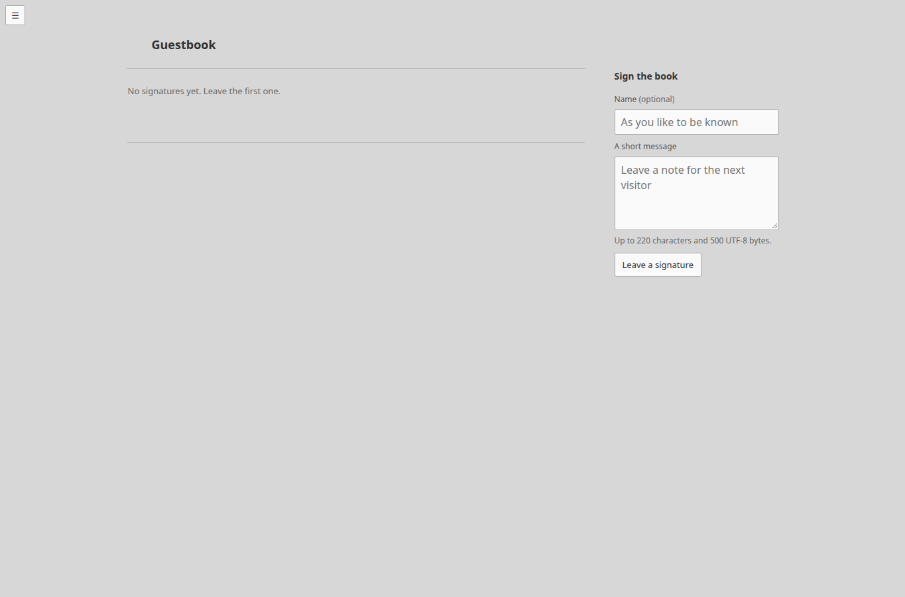
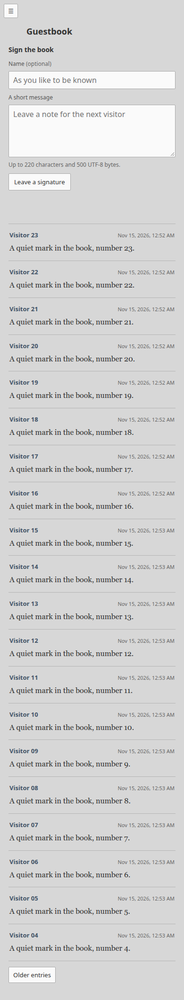
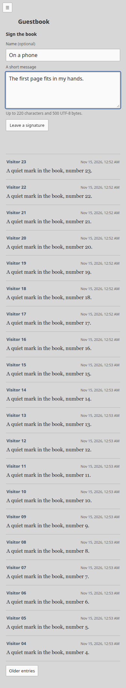

### The Story

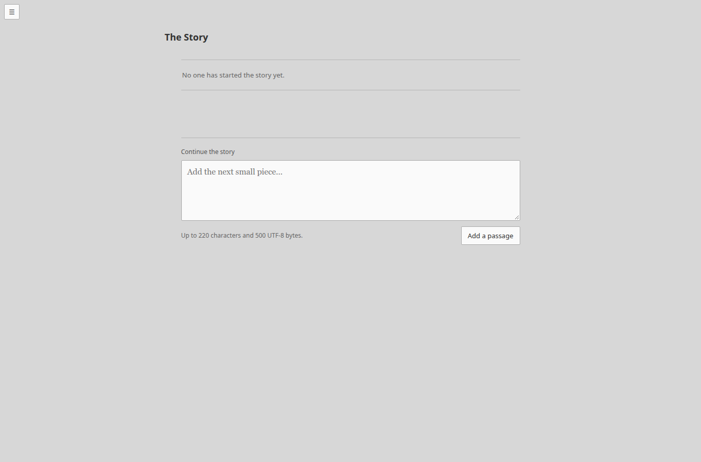
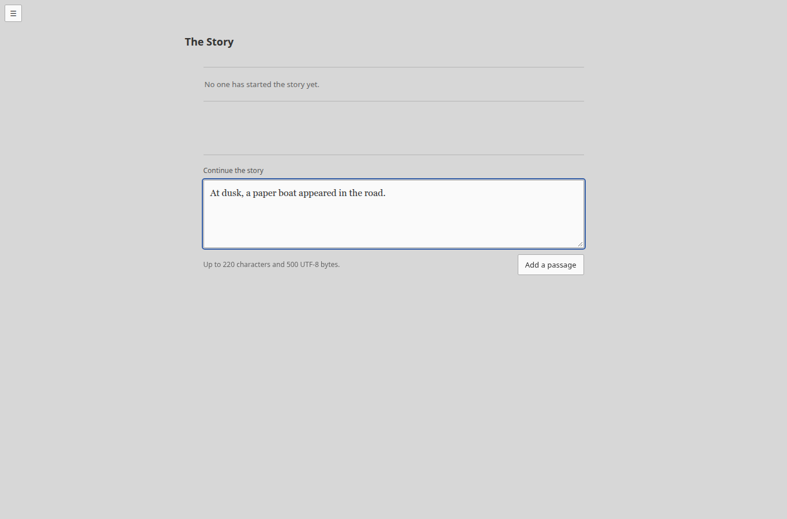
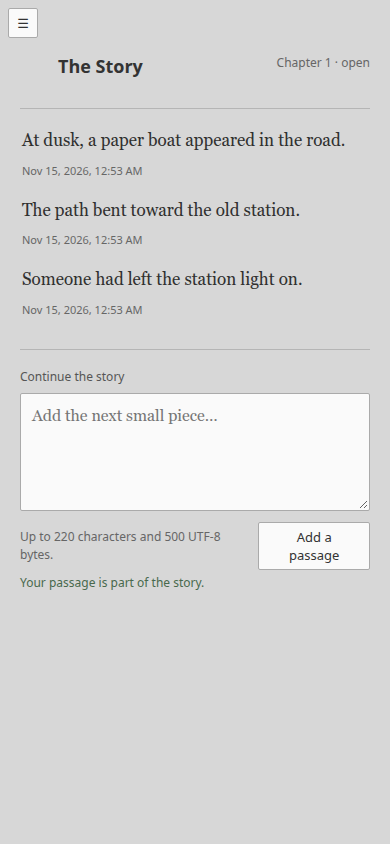
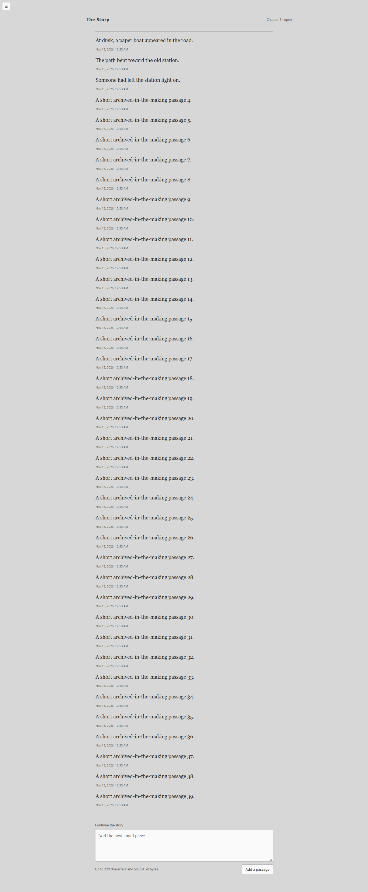

### Open Questions

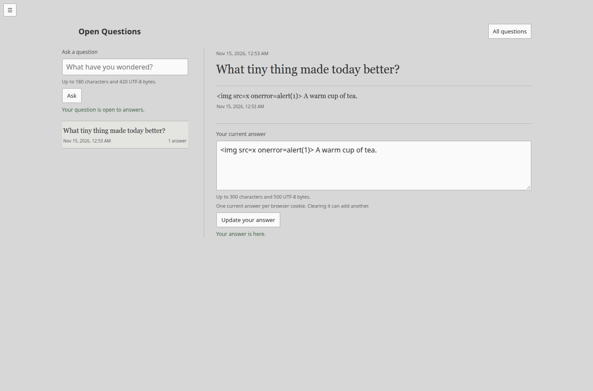
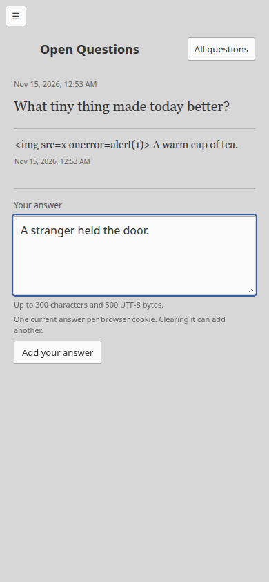

### The Choice

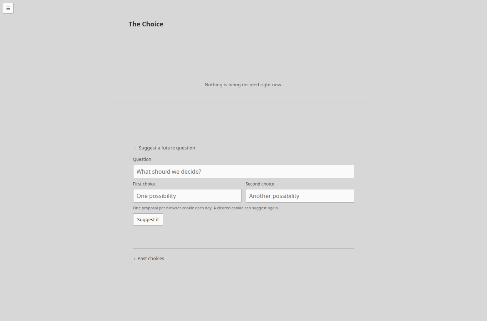
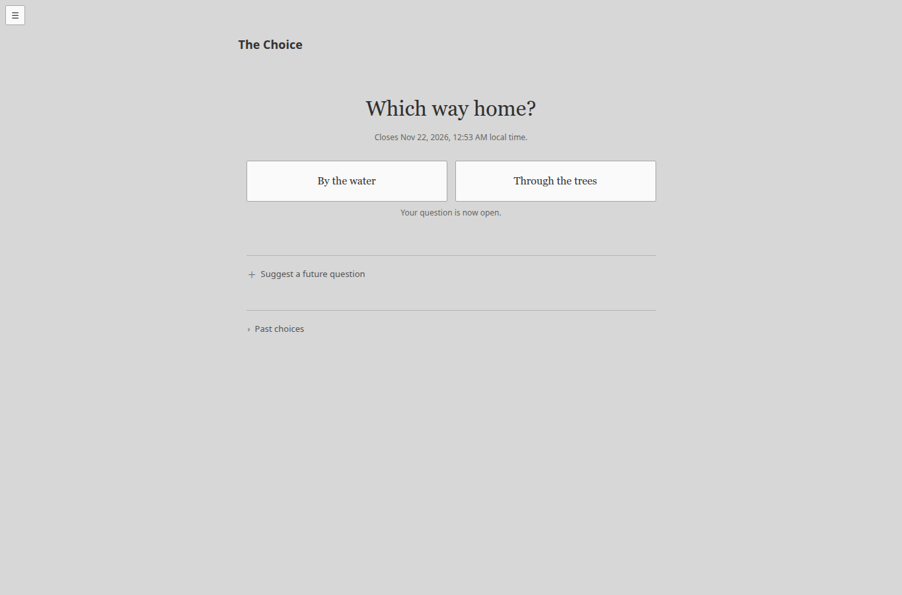
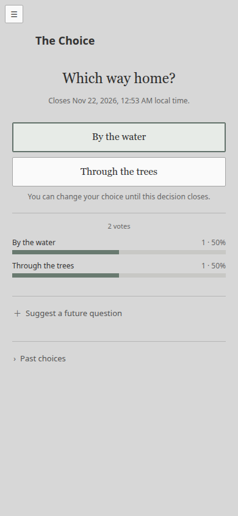
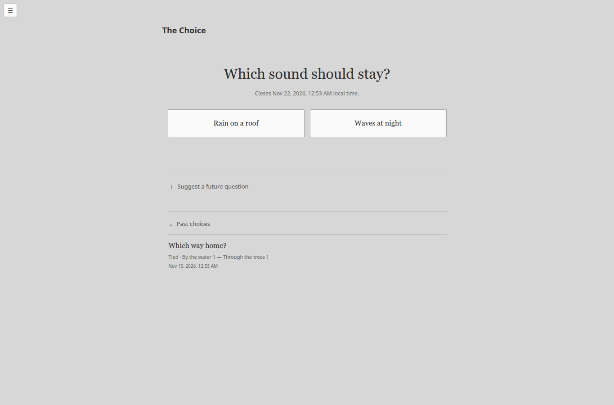

`tests/expansion.browser.mjs` captures these states and checks the interactions. The unit tests cover deterministic limits, chapter/decision boundaries, and persistence; `tests/migration-forward-compat.test.ts` exercises the migration and rollback sequence on a disposable database.
