# Final spaces

The Drawing Board, The Garden, and Visitors Map complete the planned collection at exactly ten spaces. They use the existing Astro frontend, Fastify process, anonymous cookie, shared security middleware, and SQLite WAL database. None uses WebSockets, an external service, a background worker, an account, or a new database. The synthetic examples in the screenshots and browser review were created only in disposable test databases.

## 08 — The Drawing Board

Route: /draw

Visitors draw freely on a 1000 × 700 logical paper using a pointer, touch, pen, or keyboard. The compact tools are Pen, Eraser, six colours, three brush sizes, Undo, Redo, Clear, and Leave it. Pointer capture and cancellation close strokes cleanly; pointer coordinates are scaled into the fixed logical surface so resizing does not change saved proportions. The paper uses touch-action none while drawing, so a finger stroke does not scroll the page.

The keyboard alternative focuses the paper, moves the brush with the arrow keys, uses Space to start or extend a line, and Escape to end it. Gallery cards open an accessible dialog and render only validated vector primitives on a controlled Canvas; visitor markup, SVG, and image files are never accepted.

- POST /api/draw/drawings accepts bounded strokes. The route has a 24 KiB body limit only for this endpoint; the shared body limit remains 1 KiB. Normalized vector data is limited to 20,000 bytes, 60 strokes, 120 points per stroke, 1,000 points total, the fixed paper bounds, six colour indices, and three brush sizes.
- GET /api/draw/drawings and GET /api/draw/drawings/{id} read the collection. Gallery pages contain 12 drawings and use a bounded before-ID cursor.
- A browser may submit once every five minutes; an address can submit up to eight per hour. Drawings contain no visitor digest. Short-lived cooldown digests are private and capped at 50,000.
- Retention is the first of 180 days or 1,500 stored drawings. New work removes expired or oldest rows transactionally. There are no likes, rankings, or view counts.
- Remove a drawing in the operator shell with: DB_PATH=/absolute/path/to/open-web.sqlite node /opt/the-open-web/current/dist/apps/server/src/spaces/draw/remove-drawing.js DRAWING_ID

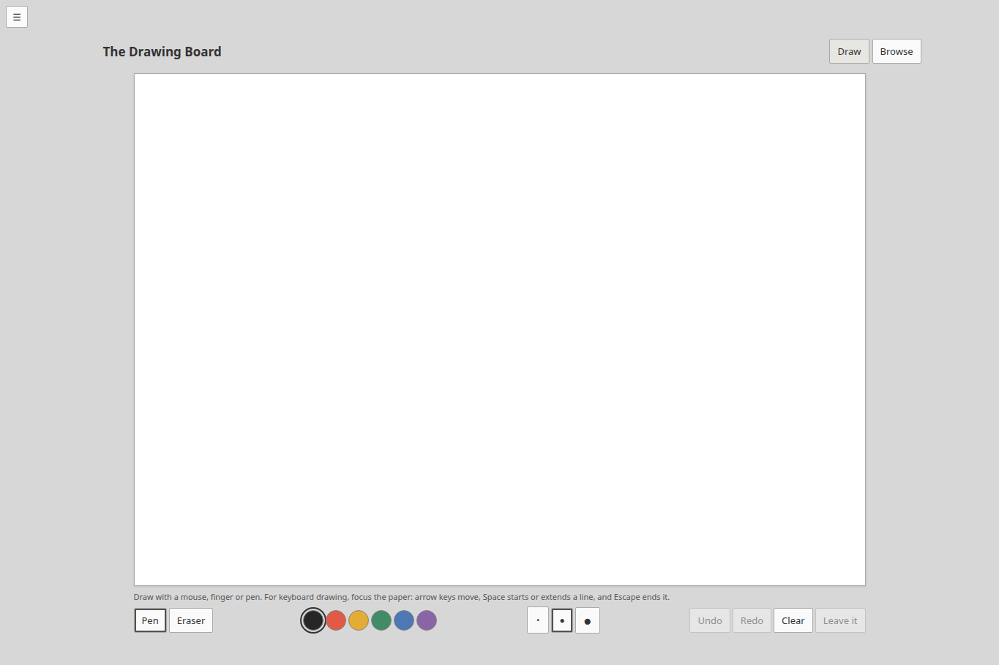

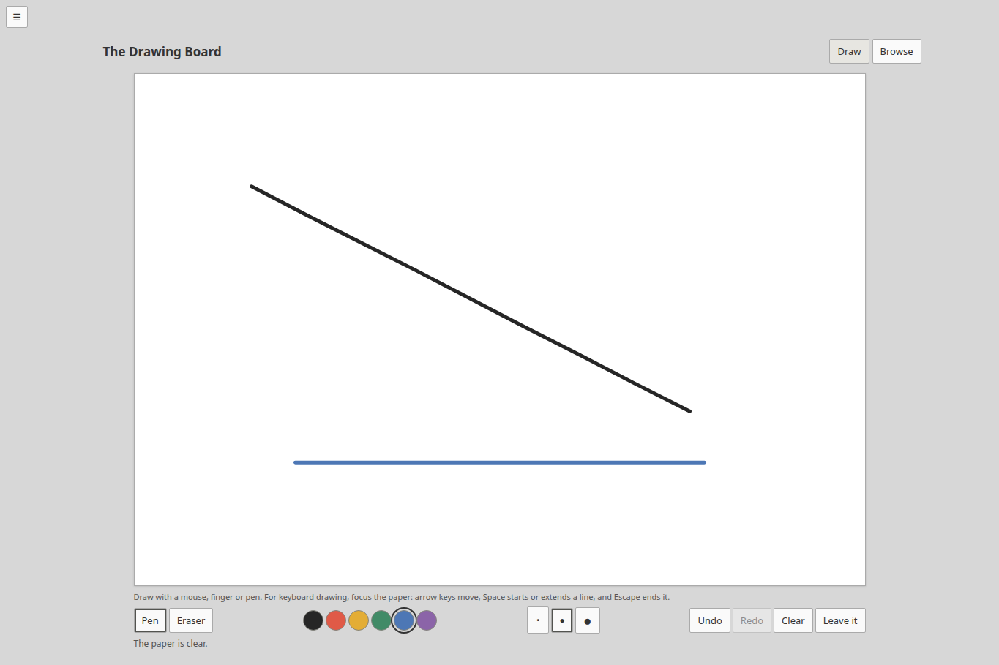

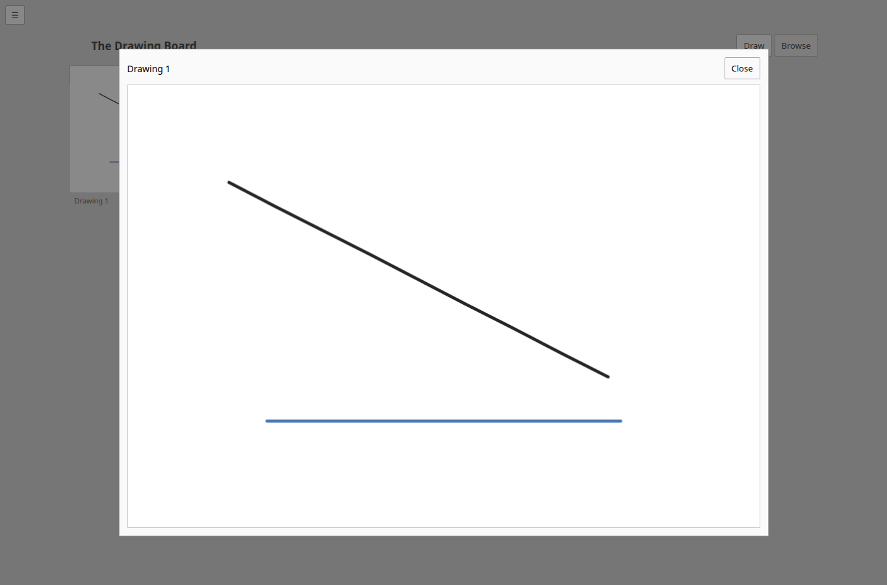

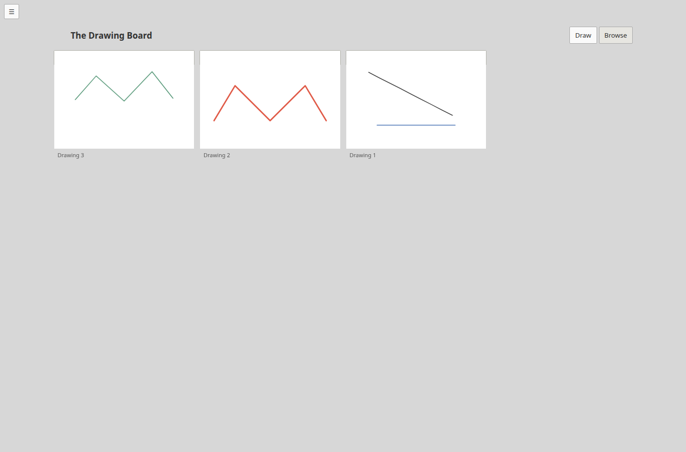

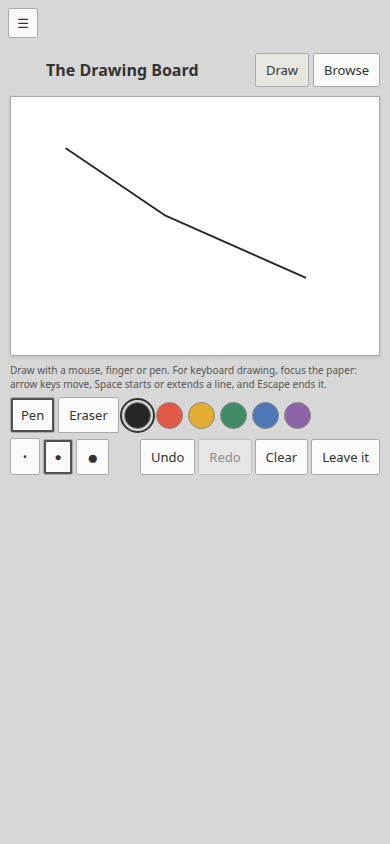

## 09 — The Garden

Route: /garden

The garden is an 18 × 10 field of bounded plots, drawn procedurally on Canvas. Visitors choose one of five simple plants—clover, wildflower, sunflower, grass, or sapling—and an open plot. A tap can select a plot, while the adjacent selector provides a precise keyboard and screen-reader alternative. A plant is placed once; concurrent attempts for the same plot are serialized and only one can succeed.

The server calculates the growth stage from the plant's creation time on every state read. No timer or visitor session is needed:

- Seed: younger than one minute.
- Sprout: one minute to 30 minutes.
- Young plant: 30 minutes to 24 hours.
- Mature: 24 hours until 90 days.
- At 90 days, the plant expires and its plot becomes available.

Growth is deterministic. Expired rows are removed during reads, writes, and routine in-process maintenance. The garden has a finite capacity of 180 plants. When it is full, a planting request is refused with a clear message; no active plant is silently replaced. A plot opens when a plant reaches its 90-day limit.

- GET /api/garden/state returns the shared snapshot.
- POST /api/garden/plants accepts an integer plot position and one of the five plant types.
- A browser can plant once every 30 minutes. The per-address bucket has a burst of five and refills at one request per minute. Cooldown digests are private, expire with the cooldown, and are capped at 50,000. Plant records do not contain visitor digests.
- Remove a plant in the operator shell with: DB_PATH=/absolute/path/to/open-web.sqlite node /opt/the-open-web/current/dist/apps/server/src/spaces/garden/remove-plant.js PLANT_ID

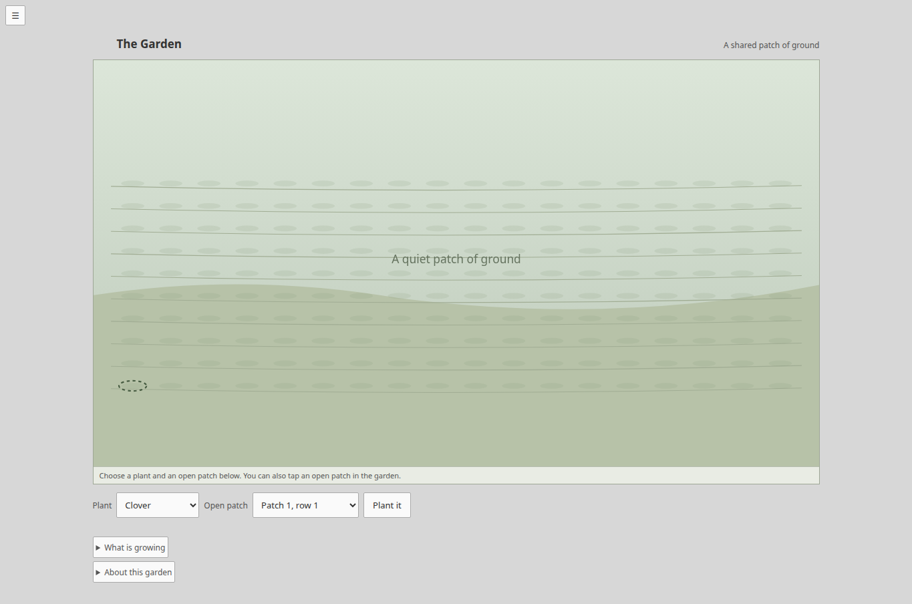

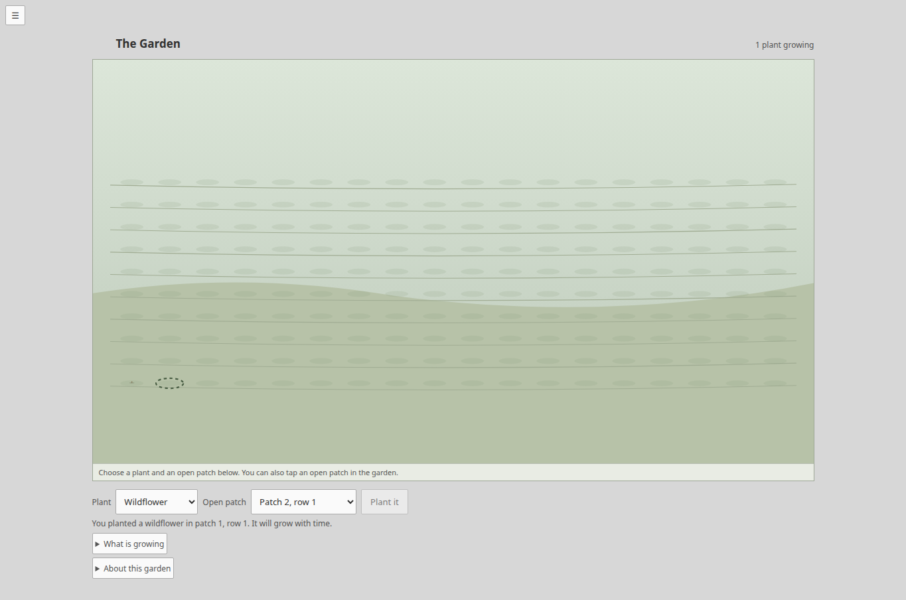

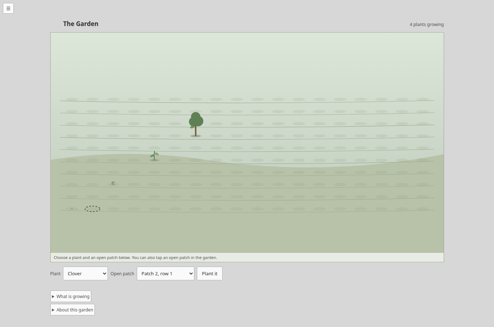

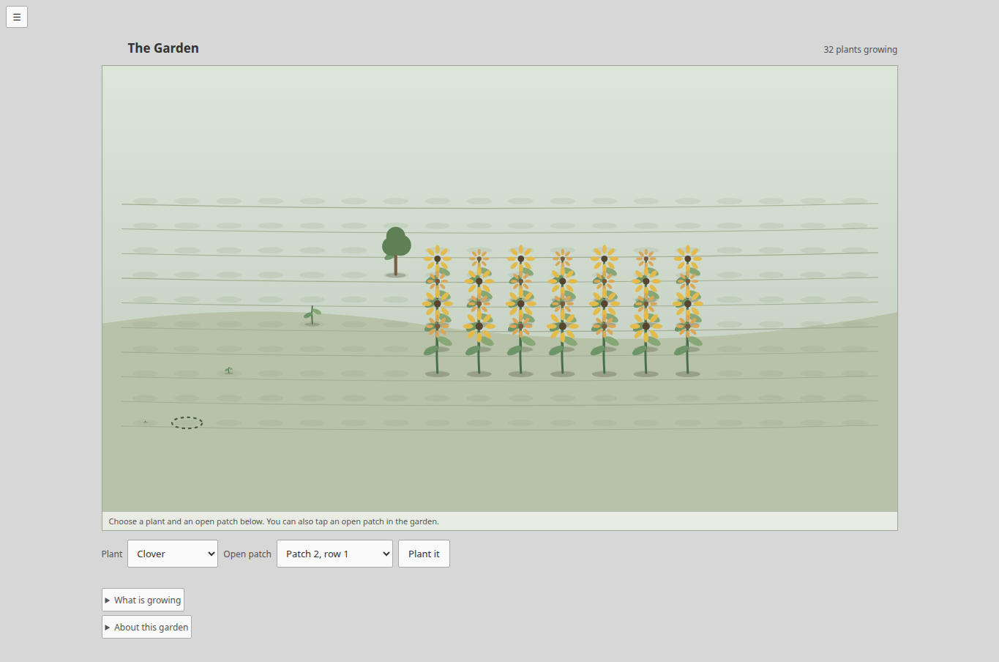

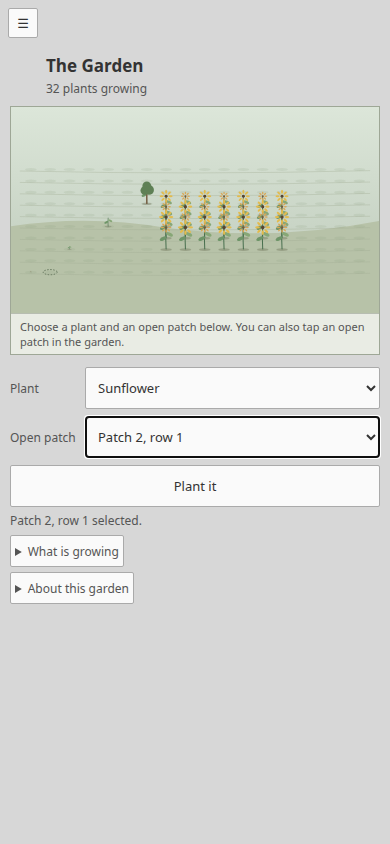

## 10 — Visitors Map

Route: /map

The map shows countries people have voluntarily chosen. It never requests browser geolocation, reads GPS, estimates location from an IP address, or sends a map request to an outside service. Visitors choose a country themselves from an accessible country list; tapping a visible country on the map is an additional option. Public results show only aggregate counts and the requesting browser's own current country. Individual contribution times and private identifiers are not returned.

The country list uses the 249 ISO 3166-1 alpha-2 codes. The bundled, simplified world boundary file is generated from Natural Earth Admin 0 Countries, version 5.1.1, at 1:50m scale. Natural Earth's data is public domain under its [official terms of use](https://www.naturalearthdata.com/about/terms-of-use/); the source dataset is listed on its [official 1:50m cultural vectors page](https://www.naturalearthdata.com/downloads/50m-cultural-vectors/). The generated asset is about 266 KB and makes no runtime map-service request. At this generalized scale, 13 country or territory codes have no separate polygon in the source geometry; they remain available in the country picker. Kosovo geometry from the source is omitted because XK is not an ISO 3166-1 alpha-2 code.

- GET /api/map/state returns sorted country aggregates, their total, and the requesting browser's own country if it has one. It does not create a cookie or contribution.
- POST /api/map/contribution accepts one ISO alpha-2 country code, or null to remove the current browser's mark. A later choice changes that browser's existing row.
- Writes are limited to ten per network address per hour using bounded process memory. Network addresses are not stored.
- The database keeps one private cookie digest per contribution so a visitor can later change or remove the choice. No IP address is stored. Clearing the browser cookie may make an old mark unchangeable and can allow a second mark; these are browser-level limits, not verified-person totals.
- Contributions are retained without automatic expiry and capped at 100,000 rows. At capacity, new marks are refused; existing visitors may change or remove their own mark. Operators can remove or correct a contribution in a private shell using its digest: DB_PATH=/absolute/path/to/open-web.sqlite node /opt/the-open-web/current/dist/apps/server/src/spaces/map/remove-contribution.js SHA256_VISITOR_DIGEST. Do not put that digest into public logs or reports.

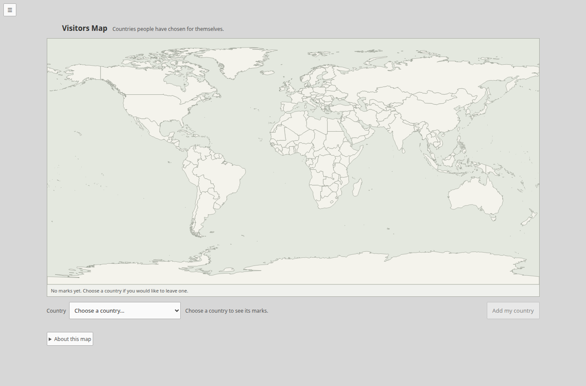

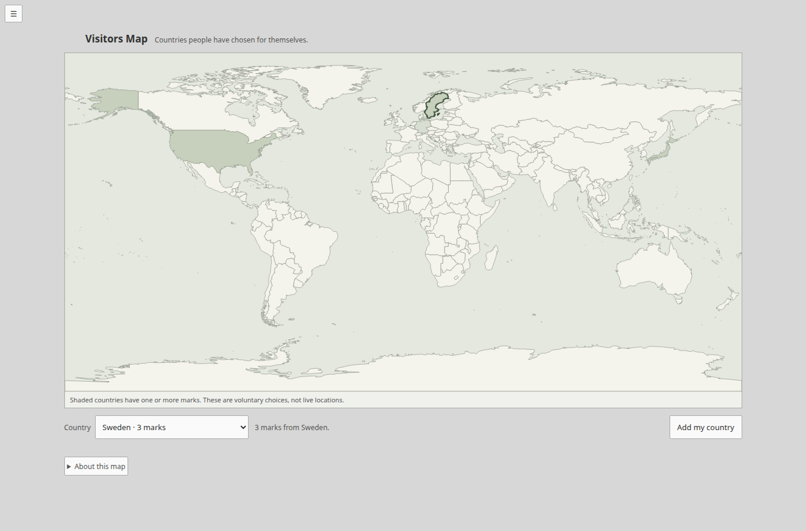

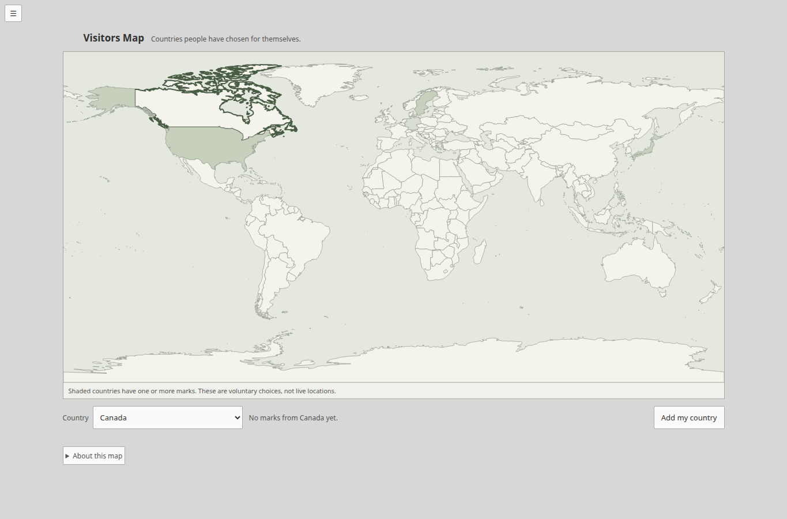

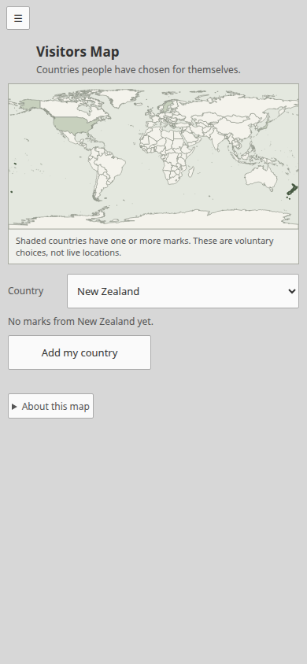

## Storage and operation

Migration 006 owns only three table groups: draw_drawings and draw_visitor_cooldowns; garden_plants and garden_visitor_cooldowns; map_contributions. All are strict SQLite tables with bounded fields and space-prefixed indexes. The map digest is private and necessary for later changes; drawings and plants do not retain visitor digests. See [DATABASE.md](DATABASE.md), [IDENTITY-PRIVACY.md](IDENTITY-PRIVACY.md), and [ROLLBACK-COMPATIBILITY.md](ROLLBACK-COMPATIBILITY.md).

The browser review covers mouse drawing, keyboard drawing, touch drawing, submission, undo/redo/clear, gallery viewing, touch plot selection and planting, map and picker selection, country add/change/remove, empty and populated scenes, and five viewport sizes. Axe checks run on desktop and mobile for every active space. Screenshots and synthetic state are under docs/screenshots/final-spaces/.
